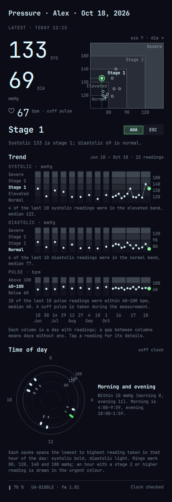
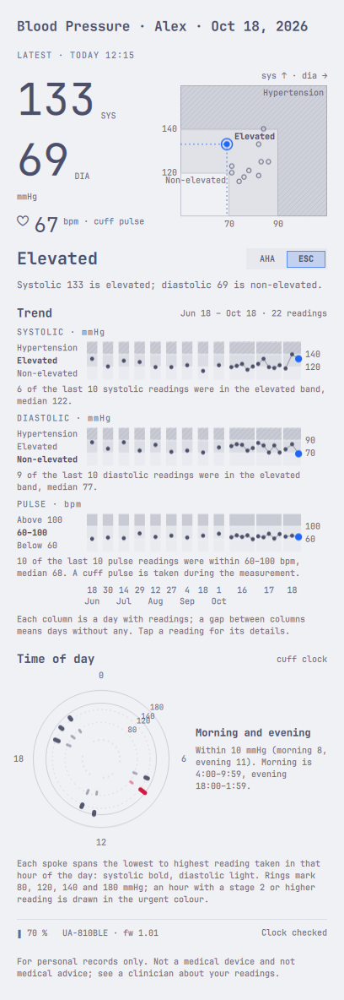
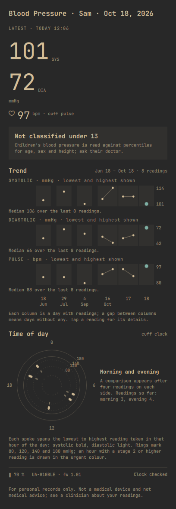
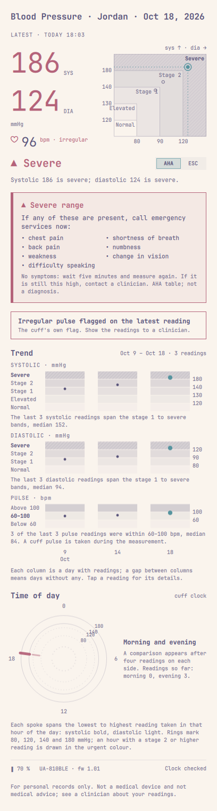
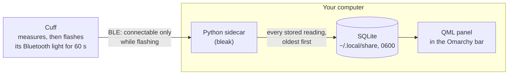

<h1 align="center">Omarchy Blood Pressure</h1>

<p align="center"><b>Your blood-pressure cuff, synced to your desktop. Nothing leaves your computer.</b></p>

<p align="center">
  <a href="https://github.com/jmcanana/omarchy-blood-pressure/actions/workflows/tests.yml"></a>
  <a href="LICENSE"></a>
  
  
  
  
  
  
</p>

<p align="center">
  
</p>

An [Omarchy](https://omarchy.org) bar plugin for home blood-pressure monitors. Take a measurement and, while the cuff's Bluetooth light flashes, every stored reading syncs to a local database. It then draws each person's readings against the published bands, in your Omarchy theme.

> [!IMPORTANT]
> A hobby project, **not a medical device and not medical advice**. Read the [disclaimer](#disclaimer) before relying on anything it shows.

## Features

- 🩺 **Hands-off sync.** Connects in the cuff's 60-second Bluetooth window and takes the whole backlog, oldest first. There is no app and no account.
- 🗺️ **The reading on the map.** The latest systolic and diastolic sit on the AHA table drawn as a map, with the previous ten readings, so you can see *why* a reading is stage 1.
- 📈 **Trends against healthy bands.** Systolic, diastolic and pulse each run on equal-height band lanes, with a plain sentence beneath, such as "7 of the last 10 diastolic readings were in the normal band, median 76".
- 🕐 **Time-of-day dial.** Each hour's spoke spans its lowest to highest reading, with morning and evening medians compared once the cuff clock is verified.
- 🔀 **AHA or ESC 2024.** One tap switches the table, and the map, lanes and sentences all redraw from the same band data.
- 👨‍👩‍👧 **The whole household.** Patients are bound to cuff user 1 or 2. Under-13s are shown without adult bands, and a reading above the crisis line shows severe guidance at any age.
- 🎨 **Theme-native.** Every colour comes from the active Omarchy theme, and severity is legible in greyscale too.
- 📋 **Copy image.** One button puts a PNG of the panel on your clipboard, for your doctor.

## Screenshots

Every number and name below is synthetic, seeded by `pressure/demo.py`. None is a real measurement.

| Adult, AHA table | Same reading, ESC 2024 table |
|---|---|
|  |  |
| **Under 13: numbers without bands** | **Above the crisis line: severe guidance** |
|  |  |

## How it works



- **Connect only while the light flashes.** The cuff advertises a connectable packet only in that window. The sidecar ignores its other beacons: the START burst and the idle iBeacon.
- **Stay quiet while it sends.** The sidecar subscribes and then sends nothing until the records stop; requests between records made the cuff stop early. After that it reads the battery and checks the cuff clock, which it never writes.
- **Compute in Python, draw in QML.** `pressure/view.py` computes every position, so the panel draws exactly the bands it classifies with.

[`DESIGN.md`](DESIGN.md) records what the cuff actually does on the air, with the evidence.

## Supported monitors

| Monitor | Status |
|---|---|
| A&D UA-810 (advertises as `UA-810BLE`) | Tested: single and three-measurement modes |
| Other monitors with the Bluetooth SIG Blood Pressure service (`0x1810`) | Should work through the generic path; untested |

Reports for other monitors are welcome.

## Install

You need Omarchy, a Bluetooth adapter, and Python 3.12 or newer.

```sh
git clone https://github.com/jmcanana/omarchy-blood-pressure
cd omarchy-blood-pressure

# The sidecar's private Bluetooth library (no root needed).
# Skip this and the panel shows a "Bluetooth library not installed" card with the same command to copy.
python3 -m venv ~/.local/share/jmcanana.pressure/venv
~/.local/share/jmcanana.pressure/venv/bin/pip install "bleak==3.0.2"

# Load it into the shell
rsync -a --delete --exclude .git --exclude docs ./ ~/.config/omarchy/plugins/jmcanana.pressure/
omarchy-shell shell rescanPlugins
omarchy plugin enable jmcanana.pressure --section right
```

Then:

1. **Clear the radio.** Turn the phone's Bluetooth off, or forget the cuff there: the cuff talks to one receiver at a time.
2. **Pair once.** The first time, hold START on the cuff until `Pr` shows, and accept the desktop pairing prompt.
3. **Trust the cuff.** Click **BP** in the bar and add a patient with `+`. Take a measurement; when "New monitor nearby" appears, tap **Trust this monitor**.
4. **Sync.** From the next measurement on, readings sync by themselves while the cuff's light flashes.

To remove it, run `omarchy plugin disable jmcanana.pressure`, then `omarchy plugin remove jmcanana.pressure`. Your database in `~/.local/share/jmcanana.pressure/` is kept. After changing the sidecar, run `omarchy restart shell`.

## Privacy

- **Everything stays on this computer.** Readings and names live in one SQLite file (mode 0600, in a 0700 directory). There is no network, no account and no telemetry upload.
- **The bar is discreet.** It shows only `BP`, `Sync`, `Ready` or `New`, and turns the theme's urgent colour for stage 2 and above. It never shows a number or a name.
- **The repository holds no real data.** Tests and screenshots use synthetic data only.

## Development

```sh
python3 -m unittest discover -s tests -v          # no radio and no captured data needed
python3 pressure/sidecar.py --self-check --data /tmp/bp/data --state /tmp/bp/state
python3 pressure/sidecar.py --demo --data /tmp/bp-demo/data --state /tmp/bp-demo/state
omarchy plugin validate .
```

QML lint, outside the live plugin directory:

```sh
mkdir -p /tmp/qs-shadow/qs
ln -sfn /usr/share/omarchy/shell/Ui /tmp/qs-shadow/qs/Ui
ln -sfn /usr/share/omarchy/shell/Commons /tmp/qs-shadow/qs/Commons
/usr/lib/qt6/bin/qmllint -I /tmp/qs-shadow Panel.qml MapChart.qml LaneStrip.qml HourDial.qml SyncPill.qml Segmented.qml ActionButton.qml
```

Lint `BarWidget.qml` and `Service.qml` as copies under other names. A file named `BarWidget.qml` makes qmllint report an inheritance cycle against the shell type of the same name.

## Disclaimer

- **Not a medical device.** This is a personal hobby project for keeping home readings. It is not a medical device, has not been reviewed or approved by any regulator, and does not diagnose, treat or monitor any condition.
- **Not medical advice.** The bands, sentences and guidance it shows restate published tables (AHA, ESC 2024, AAP 2017) for information only. Do not make medical decisions from it; talk to a qualified clinician. In an emergency, call your local emergency number.
- **No warranty, no liability.** The software is provided "as is", without warranty of any kind, and the authors are not liable for any claim, damages or other liability arising from its use (see [`LICENSE`](LICENSE)). Readings can be missed, delayed, mis-parsed or mis-classified; you use it at your own risk.
- **Tested narrowly.** It was built against one A&D UA-810 on one Omarchy machine. Other monitors, firmware or Bluetooth stacks may behave differently.
- **Your data is yours to protect.** Readings and patient names are stored unencrypted in your home directory (files mode 0600). Securing that computer, and anything you share with "Copy image", is up to you.
- **No affiliation.** Not affiliated with or endorsed by A&D Company / A&D Medical, the American Heart Association, the European Society of Cardiology, the American Academy of Pediatrics, or the Omarchy project. Product names are trademarks of their owners.

## Sources

- **AHA:** American Heart Association, [Understanding Blood Pressure Readings](https://www.heart.org/en/health-topics/high-blood-pressure/understanding-blood-pressure-readings), page updated August 2025. The pulse range of 60–100 is used only as a label beside a cuff pulse.
- **ESC 2024:** European Society of Cardiology, Guidelines for the management of elevated blood pressure and hypertension. The bands are non-elevated, elevated and hypertension.
- **AAP 2017:** American Academy of Pediatrics clinical practice guideline, which applies the adult cut-offs from age 13.

## Licence

[MIT](LICENSE)
